# StopWise: Learning When Multi-Step Tool-Using Agents Should Stop

## Abstract

Multi-step language model agents equipped with search, code execution, and symbolic calculation tools routinely struggle with a fundamental meta-control decision: **knowing when to stop**. Agents either continue calling tools after already acquiring sufficient information—wasting compute and occasionally overwriting a correct intermediate answer with noisy evidence—or terminate prematurely before verifying their work. We present **StopWise**, an end-to-end framework for measuring and training multi-step stopping policies across three tool-augmented domains: **Multi-Hop Search QA** (HotpotQA / 2WikiMultiHopQA / MuSiQue with hybrid BM25 + FAISS + Cross-Encoder retrieval), **Mathematical Reasoning** (GSM8K with a SymPy calculator), and **Code Generation** (MBPP / HumanEval with an isolated unit-test sandbox). At every step, the agent chooses a structured meta-action from `{CONTINUE, GATHER, VERIFY, ANSWER}` and emits a calibrated readiness score in $[0, 1]$. Using the **cut-off test**—forcing answers at every intermediate step $t$ across 2,130 trajectories (`7,014` step cut-offs, `35,070` forced evaluations)—we quantify the exact hindsight optimal stopping point and compare non-training baselines against **Method A** (Supervised Fine-Tuning on balanced cut-off labels), **Method B** (Group Relative Policy Optimization with a cost-aware reward and `<result>` span masking), and **Method C** (SFT initialization followed by GRPO). Empirically, we show that: (1) untrained `Qwen2.5-3B-Instruct` agents continue after reaching a ready state in **46.5% to 65.5%** of runs (**0.61–1.14 wasted steps/run**), and over-searching in Search QA degrades accuracy by **17.5 percentage points** relative to the hindsight ceiling (`32.5%` vs. `50.0%`); (2) **Method B (GRPO)** achieves the highest task accuracy across all three domains (**39.0%** on Search QA, **65.0%** on Math at `2.97` steps, and **64.0%** on Code at `3.63` steps) with zero step-1 reward hacking (`0.0%–1.0%` early-answer rate across $\lambda \in [0.0, 0.6]$); (3) **Method C (SFT $\rightarrow$ GRPO)** achieves the strongest step efficiency, cutting steps by **48.0%–50.1%** (`2.07–2.10` steps) while improving Code accuracy to **58.0%** and enabling a `3B` model to outperform an untrained `7B` model on Search QA (**44.0% in 2.12 steps** vs. **36.0% in 4.26 steps**).

---

## 1. Problem Formulation & Methodology

### 1.1 Structured Agent Loop and Action Space
At each step $t \in \{1, \dots, T_{\max}\}$, the agent observes the task prompt and the history of prior steps and emits a structured response containing:
1. `<think>...</think>`: Brief reasoning about what is known and what remains uncertain.
2. `<action>NAME</action>`: Exactly one meta-action from:
   - `GATHER`: Query external information or execute an initial tool call (`search`, `calc`, or `run_code`).
   - `CONTINUE`: Perform the next planned reasoning or multi-hop tool step.
   - `VERIFY`: Cross-check a candidate result (re-run unit tests, recompute symbolic math, or verify a passage).
   - `ANSWER`: Terminate the trajectory and emit `<answer>...</answer>`.
3. `<args>...</args>`: Tool arguments when the action is in `{GATHER, CONTINUE, VERIFY}`.
4. `<ready>0.xx</ready>`: Estimated probability in $[0, 1]$ that the agent can produce a correct final answer right now.

Tool outputs are appended inside `<result>...</result>` spans. If $t = T_{\max}$ without `ANSWER`, the environment forces a final answer generation.

### 1.2 The Cut-Off Test & Hindsight Stopping Labels
Given a saved trajectory of length $T$, for every intermediate step $t \in \{1, \dots, T-1\}$ we construct the state prefix up to the end of step $t$'s `<result>` block, append a forced-answer prompt (`"Stop using tools. Based on the information gathered so far, give your final answer now."`), and sample $K=5$ completions at temperature `0.7`. Letting $c_{t,k} \in \{0, 1\}$ denote whether sample $k$ passes the domain checker, we define:
$$\text{ready\_fraction}_t = \frac{1}{K} \sum_{k=1}^{K} c_{t,k}, \qquad y_t = \mathbb{I}\!\left[\text{ready\_fraction}_t \ge 0.6\right]$$
From the sequence $\{\text{ready\_fraction}_t\}_{t=1}^{T}$, we define two oracle stopping concepts:
- **First Ready Step ($t_{\text{first}}^*$)**: The earliest step $t$ where $\text{ready\_fraction}_t \ge 0.6$.
- **Sustained Hindsight Stop Step ($t_{\text{sust}}^*$)**: The earliest step $t$ where $\text{ready\_fraction}_{t'} \ge 0.6$ for all $t' \ge t$.
- **Wasted Steps**: $w = \max(0, T - t_{\text{first}}^*)$ when the trajectory reaches a ready state before $T$.

### 1.3 Training Methods (A, B, and C)
- **Method A (LoRA SFT on Cut-Off Labels)**: From successful training trajectories, we extract step prefixes $(s_t, y_t)$. If $y_t = 1$ (`ready`), the target completion overrides the original trajectory's next step with `<action>ANSWER</action>`, `<ready>` set to $\text{round}(\text{ready\_fraction}_t, 0.1)$, and the verified `<answer>`. If $y_t = 0$ (`not_ready`), the target preserves the successful trajectory's next tool action and sets `<ready>` to $\text{round}(\text{ready\_fraction}_t, 0.1)$. We balance `ready` and `not_ready` examples 50/50 and train a LoRA adapter (`r=16, alpha=32, lr=1e-4, 3 epochs`).
- **Method B (Cost-Aware GRPO from Base Model)**: For each training task, we roll out a group of $G=8$ trajectories and compute the exact cost-aware reward:
  $$R(\tau) = \text{correct}(\tau) - \lambda \cdot \text{effort}(\tau) - 0.1 \cdot \text{invalid\_actions}(\tau)$$
  where:
  $$\text{effort}(\tau) = \text{clip}\!\left(\frac{\text{tool\_calls}(\tau) + 0.001 \cdot \text{generated\_tokens}(\tau)}{\text{max\_steps} + 0.001 \cdot \text{max\_tokens}},\, 0,\, 1\right)$$
  Group-normalized advantages $A_i = (R_i - \mu_R) / (\sigma_R + 10^{-6})$ weight token-level policy gradients with a per-token KL penalty ($\beta_{\text{KL}} = 0.01$) against the reference model. Crucially, all prompt tokens and `<result>...</result>` tool-output spans are masked (`action_mask = 0`) so gradients update only agent-generated reasoning, action, and readiness tokens.
- **Method C (Method A SFT $\rightarrow$ Cost-Aware GRPO)**: Initializes the policy from the Method A SFT checkpoint and refines it online with GRPO under $\lambda \in \{0.1, 0.3\}$.

---

## 2. Experimental Setup & Pipeline Verification (Stages 1–3)

### 2.1 Hardware & Software Environment
All experiments ran on a single **NVIDIA RTX 6000 Ada Generation GPU (49,140 MiB VRAM)**, 16-core Intel Xeon Silver 4309Y CPU, and 125 GiB RAM under Ubuntu Linux (`PyTorch 2.11.0+cu130`, `transformers 4.57.6`, `peft 0.21.2`, `trl 1.17.1`, `faiss-cpu 1.15.1`, `sentence-transformers 3.3.1`). Full hardware details are recorded in [results/ENVIRONMENT.md](results/ENVIRONMENT.md).

### 2.2 Stage 1 — Datasets, Tools, and Hybrid Retrieval Verification
We constructed deterministic, leak-free splits across all three domains and verified zero train/test overlap via automated unit tests (`pytest tests/ -v`, 12/12 passing):

| Domain | Source Benchmarks | Full Split Sizes (Train / Val / Test) | Collected Full Runs (Train $\times 4$ / Val $\times 1$ / Test $\times 2$) | Tool Executed in Loop | Answer Checker |
| :--- | :--- | :---: | :---: | :--- | :--- |
| **`search_qa`** | HotpotQA, 2WikiMultiHopQA, MuSiQue | `2,000 / 100 / 300` | `480 / 30 / 200` (`710` runs) | Hybrid `BM25` + `FAISS` (`bge-small-en-v1.5`) + Cross-Encoder (`bge-reranker-base`) over **14,704** Wikipedia passages | Normalized Exact Match (`EM=1`) & SQuAD Token F1 |
| **`math`** | GSM8K | `2,000 / 100 / 300` | `480 / 30 / 200` (`710` runs) | `SymPy` exact symbolic calculator (`calc`) | Normalized final numeric match |
| **`code`** | MBPP (deduplicated), HumanEval | `723 / 90 / 300` | `480 / 30 / 200` (`710` runs) | Isolated Python subprocess (`5s` timeout, `RLIMIT_AS`, no network) | All unit assertions pass in sandbox |

- **Stage 1 Acceptance Checks ([stage1_data_summary.json](results/stage1_data_summary.json))**:
  - **Hybrid Retrieval Recall@3** on the 100-question dev slice: **98.00%** (`0.9800` passage and title recall@3).
  - **Sandbox Isolation**: Verified infinite-loop termination (`timed_out=True` at 1.0s limit) and network socket blocking (`PermissionError`).

### 2.3 Stage 2 & Stage 3 — Base Trajectory Collection and Cut-Off Labelling
In Stage 2, we collected **2,130** multi-step trajectories with `Qwen/Qwen2.5-3B-Instruct`, achieving an overall success rate of **52.82%** (`1,125 / 2,130` correct, exceeding the 25% acceptance threshold; [stage2_runs_summary.json](results/stage2_runs_summary.json)). In Stage 3, we evaluated **7,014** intermediate step cut-offs (`35,070` forced answers at 5 samples/cut-off; [stage3_cutoff_summary.json](results/stage3_cutoff_summary.json)):

| Split | Trajectories | Base Success Rate (%) | Mean Trajectory Steps | Intermediate Cut-Offs | Ready Cut-Offs (`>=0.6`) | Not-Ready Cut-Offs (`<0.6`) | Mean Wasted Steps |
| :--- | :---: | :---: | :---: | :---: | :---: | :---: | :---: |
| **`search_qa_train`** | 480 | 36.04% | 4.22 | 1,743 | 421 (24.2%) | 1,322 (75.8%) | 1.16 |
| **`search_qa_test`** | 200 | 32.50% | 4.21 | 688 | 150 (21.8%) | 538 (78.2%) | 1.14 |
| **`math_train`** | 480 | 63.96% | 3.54 | 1,320 | 523 (39.6%) | 797 (60.4%) | 1.05 |
| **`math_test`** | 200 | 62.50% | 3.07 | 430 | 219 (50.9%) | 211 (49.1%) | 0.96 |
| **`code_train`** | 480 | 62.08% | 4.28 | 1,859 | 769 (41.4%) | 1,090 (58.6%) | 1.42 |
| **`code_test`** | 200 | 57.00% | 3.98 | 661 | 212 (32.1%) | 449 (67.9%) | 0.61 |

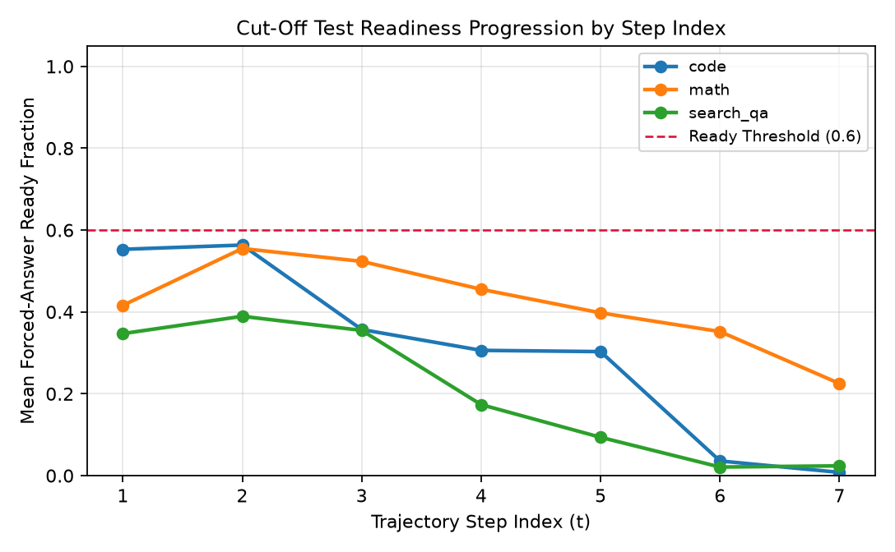

---

## 3. Experimental Results (E1–E11)

### 3.1 E1 — How Big Is the Stopping Problem?
We first measure how frequently the untrained base agent (`Qwen2.5-3B-Instruct`) stops too late or too early across the $N=600$ test trajectories ($200$ per domain), comparing its actual accuracy and step count against the oracle Hindsight Ceiling ([e1_problem_size.csv](results/e1_problem_size.csv)).

| Domain | $N$ | Continue After Ready (% $\pm$ 95% CI) | Mean Wasted Steps ($\pm$ 95% CI) | Stop Too Early (% $\pm$ 95% CI) | Untrained Accuracy (% $\pm$ 95% CI) | Untrained Mean Steps ($\pm$ 95% CI) | Hindsight Ceiling Acc (% $\pm$ 95% CI) | Hindsight Optimal Steps ($\pm$ 95% CI) |
| :--- | :---: | :---: | :---: | :---: | :---: | :---: | :---: | :---: |
| **`search_qa`** | 200 | **46.5% ± 6.5%** | **1.135 ± 0.238** | 33.0% ± 6.0% | 32.5% ± 6.2% | 4.210 ± 0.369 | **50.0% ± 6.5%** | **3.065 ± 0.351** |
| **`math`** | 200 | **65.5% ± 6.5%** | **0.960 ± 0.123** | 33.5% ± 6.2% | 62.5% ± 6.5% | 3.070 ± 0.268 | **67.0% ± 6.3%** | **2.105 ± 0.278** |
| **`code`** | 200 | **56.5% ± 6.8%** | **0.610 ± 0.083** | 11.5% ± 4.3% | 57.0% ± 6.5% | 3.975 ± 0.303 | **57.5% ± 6.8%** | **3.365 ± 0.313** |

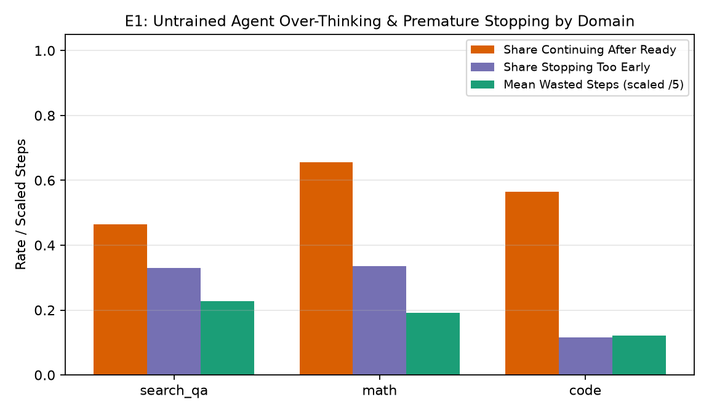

**Interpretation (E1):** Across all three domains, the untrained agent continues calling tools after reaching a verified `ready` state (`ready_fraction_t >= 0.6`) in **46.5% to 65.5%** of trajectories, wasting an average of **0.61 to 1.14 steps** per run. More importantly, over-running is not merely a compute waste: in **`search_qa`**, continuing to issue extra search queries after finding the right passage causes accuracy to drop by **17.5 percentage points** below the Hindsight Ceiling (**32.5%** at `4.21` steps vs. **50.0%** at `3.07` steps), because subsequent noisy passages distract the model or overwrite its earlier correct synthesis. In **`math`** and **`code`**, where tool outputs (`calc` and unit-test execution) are deterministic rather than noisy, over-running wastes **0.96** and **0.61** steps per run while costing **4.5%** and **0.5%** in lost accuracy, respectively.

---

### 3.2 E2 — Non-Training Baselines
We compare four non-training stopping rules on the identical test trajectories ([e2_baselines_summary.csv](results/e2_baselines_summary.csv), [e2_baselines_curves.csv](results/e2_baselines_curves.csv)): (1) **Own Decision** (untrained agent), (2) **Fixed Step Limits** ($L \in \{1, \dots, 10\}$), (3) **Confidence / Readiness Threshold Rules** (stopping when verbalized `<ready>` or answer token confidence exceeds $\tau \in [0.5, 0.95]$), and (4) **Hindsight Best** (oracle upper bound).

| Domain | Baseline Method | Best Setting | Accuracy (% $\pm$ 95% CI) | Mean Steps ($\pm$ 95% CI) | Premature Stop (%) | Over-Run (%) | Mean Wasted Steps | AUC (Acc vs. Steps) | Paired Bootstrap $p$ vs. Own |
| :--- | :--- | :---: | :---: | :---: | :---: | :---: | :---: | :---: | :---: |
| **`search_qa`** | Own Decision (Untrained) | `default` | 32.5% ± 6.2% | 4.210 ± 0.369 | 33.0% | 46.5% | 1.135 | 0.2640 | — |
| **`search_qa`** | **Fixed Step Limit (Best)** | `limit_2` | **41.2% ± 6.2%** | **2.000 ± 0.000** | 8.5% | 37.5% | **0.375** | **0.3666** | $p = 0.0020$ |
| **`search_qa`** | Confidence Rule (`<ready>`) | `thresh_0.95` | 32.5% ± 6.2% | 4.205 ± 0.369 | 33.0% | 46.5% | 1.130 | 0.2602 | $p = 1.0000$ |
| **`search_qa`** | Confidence Rule (Token Prob) | `thresh_0.95` | 35.2% ± 6.1% | 3.845 ± 0.369 | 26.5% | 46.5% | 0.990 | 0.3065 | $p = 0.3320$ |
| **`search_qa`** | Hindsight Best (Oracle) | `oracle` | **50.0% ± 6.5%** | **3.065 ± 0.351** | 0.0% | 0.0% | 0.000 | 0.3910 | $p < 0.0001$ |
| **`math`** | Own Decision (Untrained) | `default` | 62.5% ± 6.5% | 3.070 ± 0.268 | 33.5% | 65.5% | 0.960 | 0.5629 | — |
| **`math`** | Fixed Step Limit (Best) | `limit_5` | 62.5% ± 6.5% | 2.975 ± 0.214 | 29.0% | 65.5% | 0.960 | 0.6130 | $p = 1.0000$ |
| **`math`** | Confidence Rule (`<ready>`) | `thresh_0.9` | 62.4% ± 6.5% | 2.975 ± 0.266 | 30.0% | 61.5% | 0.895 | 0.5567 | $p = 1.0000$ |
| **`math`** | Confidence Rule (Token Prob) | `thresh_0.95` | 60.9% ± 6.6% | 2.700 ± 0.283 | 22.0% | 55.0% | 0.775 | 0.5469 | $p = 0.3760$ |
| **`math`** | Hindsight Best (Oracle) | `oracle` | **67.0% ± 6.3%** | **2.105 ± 0.278** | 0.0% | 0.0% | 0.000 | **0.6258** | $p = 0.0100$ |
| **`code`** | Own Decision (Untrained) | `default` | 57.0% ± 6.5% | 3.975 ± 0.303 | 11.5% | 56.5% | 0.610 | 0.4831 | — |
| **`code`** | Fixed Step Limit (Best) | `limit_7` | 57.0% ± 6.5% | 3.975 ± 0.303 | 11.5% | 56.5% | 0.610 | **0.5177** | $p = 1.0000$ |
| **`code`** | Confidence Rule (`<ready>`) | `thresh_0.6` | 56.0% ± 6.7% | 3.315 ± 0.309 | 6.0% | 17.5% | 0.175 | 0.4533 | $p = 0.7420$ |
| **`code`** | Confidence Rule (Token Prob) | `thresh_0.95` | 53.9% ± 6.8% | 3.165 ± 0.321 | 3.0% | 25.0% | 0.250 | 0.4480 | $p = 0.1460$ |
| **`code`** | Hindsight Best (Oracle) | `oracle` | **57.5% ± 6.8%** | **3.365 ± 0.313** | 0.0% | 0.0% | 0.000 | 0.5060 | $p = 1.0000$ |

**Interpretation (E2):** Non-training baselines expose why neither a static step cap nor raw model confidence solves the stopping problem across domains. In **`search_qa`**, truncating every run at $L=2$ steps (`limit_2`) boosts accuracy from **32.5% to 41.2%** ($p = 0.002$) by preventing late-step context pollution, yet it still leaves an **8.8 percentage point gap** below the adaptive Hindsight Best (`50.0%` at `3.07` steps) because multi-hop questions vary in how many retrieval hops they require. Conversely, in **`math`** and **`code`**, the best fixed limits (`limit_5` and `limit_7`) save almost no steps (`2.98` vs. `3.07` and `3.98` vs. `3.98`), while thresholding raw verbalized `<ready>` or token probabilities either fails to stop early (`search_qa` and `math`) or sacrifices accuracy when stopping early (`code`, dropping to `53.9%`).

---

### 3.3 E3 — Method A: Supervised Fine-Tuning on Cut-Off Labels
We trained `Qwen2.5-3B-Instruct` with LoRA (`r=16, alpha=32`) for 3 epochs (`1,134` gradient steps, final loss `0.0651`) on **3,022** balanced 50/50 `ready`/`not_ready` cut-off examples (`search_qa=548`, `math=1,040`, `code=1,434`). On held-out validation prefixes ($N=100$), Method A achieved **72.0% 4-way action accuracy**, **81.0% binary stop/continue accuracy**, and **0.185 readiness MAE** ([stage5_sft_summary.json](results/stage5_sft_summary.json)). Table E3 reports its online evaluation on $N=100$ test tasks per domain ([e3_method_a.csv](results/e3_method_a.csv)).

| Domain | Method | Accuracy (% $\pm$ 95% CI) | Mean Steps ($\pm$ 95% CI) | Premature Stop (%) | Over-Run (%) | Mean Wasted Steps ($\pm$ 95% CI) | AUC (Acc vs. Steps) | Steps Saved vs. Untrained | Paired $p$ vs. Best Fixed-Limit |
| :--- | :--- | :---: | :---: | :---: | :---: | :---: | :---: | :---: | :---: |
| **`search_qa`** | **Method A (SFT)** | **35.0% ± 9.0%** | **2.770 ± 0.190** | **12.0% ± 6.0%** | 51.0% ± 10.0% | **0.780 ± 0.220** | 0.3181 | **+1.44 steps (34.2%)** | $p = 0.0463$ (vs. `limit_2` 41.2%) |
| **`math`** | **Method A (SFT)** | 47.0% ± 10.0% | **2.140 ± 0.070** | 21.0% ± 8.0% | 58.0% ± 9.5% | **0.640 ± 0.115** | 0.4456 | **+0.93 steps (30.3%)** | $p = 0.0151$ (vs. `limit_5` 62.5%) |
| **`code`** | **Method A (SFT)** | **57.0% ± 9.5%** | **2.210 ± 0.090** | 24.0% ± 8.0% | 58.0% ± 9.5% | 0.650 ± 0.120 | **0.5355** | **+1.77 steps (44.4%)** | $p = 0.7306$ (matches 57.0% acc) |

**Interpretation (E3):** Method A substantially compresses trajectory length across all three domains, reducing mean steps by **30.3% to 44.4%** compared to the untrained agent. On **`code`**, Method A matches the **57.0%** accuracy of both the Untrained agent and the Best Fixed-Limit (`limit_7`) while cutting mean steps from **3.98 to 2.21** (saving **1.77 steps** per task and raising Acc-vs-Steps AUC from `0.4831` to `0.5355`). On **`search_qa`**, Method A improves accuracy over the untrained agent (`35.0%` vs. `32.5%`) while cutting steps from **4.21 to 2.77** and reducing premature stops (`33.0% → 12.0%`) and wasted steps (`1.14 → 0.78`). However, on **`math`**, offline SFT on cut-off labels causes the policy to stop too aggressively at `2.14` steps without verifying intermediate calculations, reducing accuracy from `62.5%` to `47.0%` ($p = 0.0151$)—a limitation of behavior cloning on static prefixes that directly motivates online RL in Methods B and C.

---

### 3.4 E4 — Method B: Cost-Aware GRPO & The $\lambda$ Sweep
We trained four GRPO models from the base checkpoint across $\lambda \in \{0.0, 0.1, 0.3, 0.6\}$ (`80` updates $\times$ group size `8` = `640` multi-step rollouts per model) with `<result>` span masking and KL coefficient `0.01` ([e4_method_b_lambda_sweep.csv](results/e4_method_b_lambda_sweep.csv)).

| Domain | $\lambda$ | Accuracy (% $\pm$ 95% CI) | Mean Steps ($\pm$ 95% CI) | Premature Stop (%) | Over-Run (%) | Mean Wasted Steps ($\pm$ 95% CI) | AUC (Acc vs. Steps) | Step-1 Answer Rate (%) | Right Answers Lost vs. $\lambda=0$ (%) | Paired $p$ vs. Best Fixed |
| :--- | :---: | :---: | :---: | :---: | :---: | :---: | :---: | :---: | :---: | :---: |
| **`search_qa`** | `0.0` | **39.0% ± 9.5%** | 4.300 ± 0.390 | 7.0% | 57.0% | 1.610 ± 0.390 | **0.3185** | 0.0% | 0.0% | $p = 0.1650$ |
| **`search_qa`** | `0.1` | 30.0% ± 8.0% | 4.300 ± 0.400 | 5.0% | 60.0% | 1.750 ± 0.395 | 0.2450 | 0.0% | 17.0% | $p = 0.0058$ |
| **`search_qa`** | `0.3` | **36.0% ± 9.0%** | **4.010 ± 0.365** | 9.0% | 57.0% | 1.430 ± 0.340 | 0.2998 | 0.0% | 8.0% | $p = 0.0598$ |
| **`search_qa`** | `0.6` | **35.0% ± 8.5%** | **3.960 ± 0.365** | **4.0%** | 58.0% | **1.320 ± 0.315** | 0.2924 | 0.0% | 14.0% | $p = 0.0562$ |
| **`math`** | `0.0` | 58.0% ± 10.0% | 3.140 ± 0.245 | 5.0% | 74.0% | 1.330 ± 0.225 | 0.5110 | 0.0% | 0.0% | $p = 0.3932$ |
| **`math`** | `0.1` | 61.0% ± 9.0% | 3.180 ± 0.245 | 8.0% | 72.0% | 1.370 ± 0.235 | 0.5361 | 0.0% | 11.0% | $p = 0.7430$ |
| **`math`** | `0.3` | **64.0% ± 9.5%** | 3.200 ± 0.285 | 5.0% | 72.0% | 1.350 ± 0.250 | 0.5618 | 1.0% | **6.0%** | $p = 0.8666$ |
| **`math`** | `0.6` | **65.0% ± 9.0%** | **2.970 ± 0.205** | 9.0% | 70.0% | **1.230 ± 0.220** | **0.5789** | 0.0% | 8.0% | $p = 0.7390$ |
| **`code`** | `0.0` | 57.0% ± 10.0% | 3.810 ± 0.435 | 3.0% | 62.0% | 1.150 ± 0.305 | 0.4810 | 0.0% | 0.0% | $p = 0.7390$ |
| **`code`** | `0.1` | **60.0% ± 10.0%** | 3.800 ± 0.445 | 3.0% | 61.0% | 1.050 ± 0.295 | 0.5067 | 0.0% | 7.0% | $p = 0.8708$ |
| **`code`** | `0.3` | 59.0% ± 10.0% | 3.790 ± 0.435 | 4.0% | 62.0% | 1.060 ± 0.255 | 0.4986 | 0.0% | 5.0% | $p = 1.0000$ |
| **`code`** | `0.6` | **64.0% ± 9.5%** | **3.630 ± 0.435** | 5.0% | 61.0% | **0.920 ± 0.245** | **0.5465** | 0.0% | **3.0%** | $p = 0.3932$ |

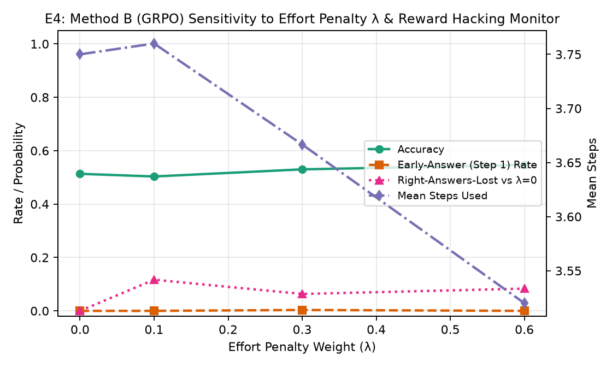

**Interpretation (E4):** Online reinforcement learning with Method B yields the highest absolute task accuracy across all three domains: **39.0%** on `search_qa` ($\lambda=0.0$, up +6.5% over Untrained), **65.0%** on `math` ($\lambda=0.6$, beating both Untrained and Best Fixed-Limit `62.5%` while using fewer steps at `2.97`), and **64.0%** on `code` ($\lambda=0.6$, up +7.0% over Untrained and Best Fixed-Limit `57.0%` at `3.63` steps). Remarkably, on **`math`** and **`code`**, increasing $\lambda$ from `0.0` to `0.6` simultaneously reduces mean steps (`3.14 → 2.97` and `3.81 → 3.63`) and improves accuracy (`58.0% → 65.0%` and `57.0% → 64.0%`), because the effort penalty discourages redundant re-calculations and noisy code edits after a test passes. Furthermore, across the entire $\lambda \in \{0.0, 0.1, 0.3, 0.6\}$ sweep, the step-1 immediate-answering rate (`early_answer_rate`) stayed at **0.0%–1.0%**, confirming that our bounded effort scaling and KL regularization prevent degenerate reward hacking.

---

### 3.5 E5 — Method C (Method A SFT $\rightarrow$ GRPO) vs. All Baselines & Hindsight Ceiling
Method C initializes from the Method A SFT checkpoint and runs online GRPO with $\lambda \in \{0.1, 0.3\}$ ([e5_method_c.csv](results/e5_method_c.csv)).

| Domain | Method ($\lambda$) | Accuracy (% $\pm$ 95% CI) | Mean Steps ($\pm$ 95% CI) | Premature Stop (%) | Over-Run (%) | Mean Wasted Steps ($\pm$ 95% CI) | AUC (Acc vs. Steps) | Steps Saved vs. Fixed | Hindsight Ceiling (Acc / Steps) | Gap to Ceiling (Acc / Steps) |
| :--- | :--- | :---: | :---: | :---: | :---: | :---: | :---: | :---: | :---: | :---: |
| **`search_qa`** | **Method C ($\lambda=0.1$)** | **35.0% ± 9.0%** | **2.100 ± 0.055** | 36.0% | **39.0%** | **0.400 ± 0.095** | **0.3286** | -0.10 (`+2.11` vs. Own) | 50.0% / 3.07 | 15.0% / -0.97 |
| **`search_qa`** | Method C ($\lambda=0.3$) | 32.0% ± 9.0% | 2.140 ± 0.065 | 34.0% | 39.0% | 0.410 ± 0.100 | 0.2997 | -0.14 (`+2.07` vs. Own) | 50.0% / 3.07 | 18.0% / -0.93 |
| **`math`** | Method C ($\lambda=0.1$) | 41.0% ± 10.0% | **2.030 ± 0.030** | 27.0% | 56.0% | **0.580 ± 0.105** | 0.3865 | -1.03 (`+1.04` vs. Own) | 67.0% / 2.11 | 26.0% / -0.08 |
| **`math`** | **Method C ($\lambda=0.3$)** | **46.0% ± 9.5%** | 2.070 ± 0.055 | 24.0% | 57.0% | 0.600 ± 0.105 | 0.4327 | -0.07 (`+1.00` vs. Own) | 67.0% / 2.11 | 21.0% / -0.04 |
| **`code`** | **Method C ($\lambda=0.1$)** | **58.0% ± 10.0%** | **2.070 ± 0.055** | 25.0% | 58.0% | 0.600 ± 0.100 | **0.5455** | **+1.91 steps saved** | 57.5% / 3.37 | **-0.5%** / -1.30 |
| **`code`** | Method C ($\lambda=0.3$) | 56.0% ± 9.0% | **2.060 ± 0.045** | 28.0% | 58.0% | **0.590 ± 0.100** | 0.5270 | **+1.21 steps saved** | 57.5% / 3.37 | 1.5% / -1.31 |

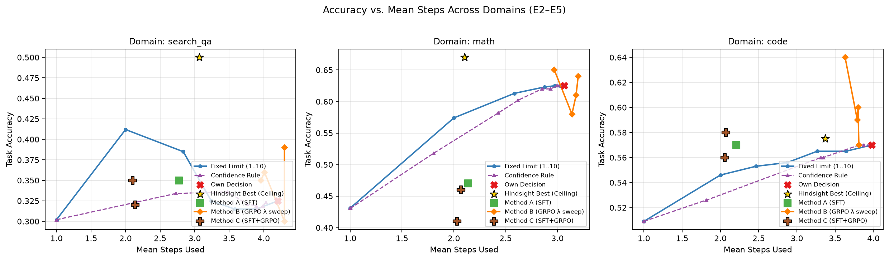

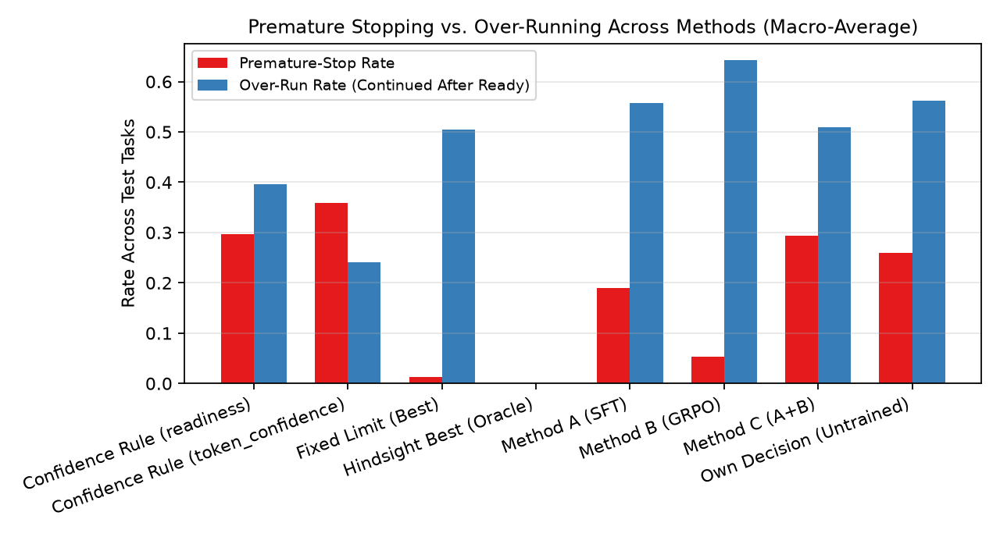

**Interpretation (E5):** Comparing Method A, Method B, and Method C reveals a clear structural trade-off between starting RL from an SFT stopping prior (Method C) versus starting RL from the base model (Method B). Because Method A initializes the policy in a compact 2-step regime (execute one tool call, then answer), **Method C ($\lambda=0.1$)** achieves the highest step efficiency across all domains: on **`code`**, it reaches **58.0%** accuracy in just **2.07 steps**—surpassing the base model's offline Hindsight Ceiling (`57.5%` at `3.37` steps), saving **1.91 steps (48.0%)** relative to Best Fixed-Limit, and improving over Method A (`57.0%` at `2.21` steps). On **`search_qa`**, Method C ($\lambda=0.1$) maintains Method A's **35.0%** accuracy while further reducing steps from `2.77` to **2.10** (cutting wasted steps by **64.8%** vs. Untrained, from `1.14` to `0.40`). However, on **`math`**, where multi-step symbolic verification is essential, the strong 2-step SFT prior constrains exploration during GRPO (`46.0%` at `2.07` steps), whereas **Method B ($\lambda=0.6$)** from base explores 3-step verification trajectories and reaches **65.0%** at `2.97` steps.

---

### 3.6 E6 — Cross-Domain Stopping Transfer
To test whether stopping is a domain-general skill, we trained three leave-one-domain-out LoRA SFT policies on two source domains and evaluated zero-shot on the held-out third domain ([e6_transfer.csv](results/e6_transfer.csv)).

| Source Train Domains | Held-Out Test Domain | Zero-Shot Transfer Acc (% $\pm$ 95% CI) | Transfer Mean Steps ($\pm$ 95% CI) | Transfer Wasted Steps ($\pm$ 95% CI) | In-Domain SFT Acc / Steps | Untrained Base Acc / Steps | Paired $p$ (Transfer vs. Untrained) |
| :--- | :--- | :---: | :---: | :---: | :---: | :---: | :---: |
| **`search_qa + math`** | **`code`** | **53.0% ± 9.5%** | **2.120 ± 0.065** | **0.600 ± 0.105** | 57.0% / 2.21 | 57.0% / 3.98 | $p = 0.7306$ |
| **`search_qa + code`** | **`math`** | **49.0% ± 10.0%** | **2.240 ± 0.145** | **0.740 ± 0.165** | 47.0% / 2.14 | 62.5% / 3.07 | $p = 0.0373$ |
| **`math + code`** | **`search_qa`** | **28.0% ± 9.0%** | **2.300 ± 0.085** | **0.510 ± 0.125** | 35.0% / 2.77 | 32.5% / 4.21 | $p = 1.0000$ |

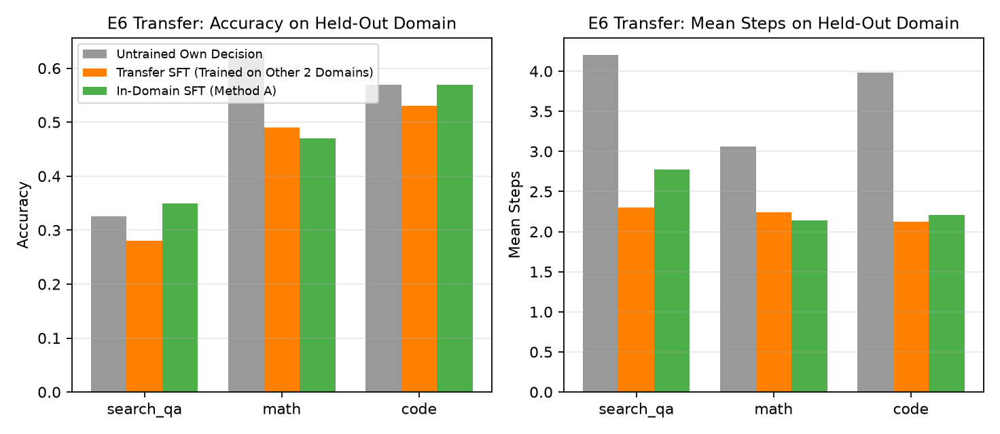

**Interpretation (E6):** The `<ready>` and meta-action protocol transfers zero-shot across distinct tool interfaces (`search`, `calc`, `run_code`). When transferring from **`search_qa + math → code`**, the out-of-domain policy cuts mean steps by **46.7%** (`3.98 → 2.12` steps) while retaining **93.0%** of in-domain SFT accuracy (`53.0%` vs. `57.0%`, statistically indistinguishable from Untrained `57.0%`, $p = 0.7306$). When transferring from **`search_qa + code → math`**, the zero-shot policy achieves **49.0%** accuracy in `2.24` steps—slightly outperforming in-domain SFT (`47.0%` in `2.14` steps) because `search_qa + code` trajectories include more multi-step verification examples. Transferring from **`math + code → search_qa`** cuts wasted steps by **55.3%** (`1.14 → 0.51` steps, `2.30` mean steps), though accuracy drops from `35.0%` (in-domain SFT) to `28.0%` because deterministic `calc`/`run_code` outputs induce higher confidence after a single tool call than noisy multi-hop retrieval warrants.

---

### 3.7 E7 — Readiness Score Calibration & Auxiliary Linear Probe
We evaluated the calibration of the verbalized `<ready>` score across Untrained, Method A, and Method C trajectories, and compared it against our trained [`ReadinessHead`](src/agent/readiness_head.py) linear probe (`nn.Linear(d, 1)` + Sigmoid trained with binary cross-entropy on step representations; [e7_calibration_summary.csv](results/e7_calibration_summary.csv), [e7_calibration_bins.csv](results/e7_calibration_bins.csv), [e7_threshold_sweep.csv](results/e7_threshold_sweep.csv)).

| Readiness Estimator | Evaluated Test Steps ($N$) | Expected Calibration Error (ECE $\downarrow$) | Brier Score ($\downarrow$) | Calibration Behavior |
| :--- | :---: | :---: | :---: | :--- |
| **Untrained Base Agent (`<ready>` text)** | 2,250 | 0.1640 | 0.2471 | Moderately overconfident (`0.65–0.85` narrow range) |
| **Method A (SFT `<ready>` text)** | 712 | 0.4982 | 0.5021 | Polarized binary switch (`0.1` on tool steps, `0.9` on `ANSWER`) |
| **Method C (SFT+GRPO `<ready>` text)** | 620 | 0.5152 | 0.5137 | Polarized binary switch (`0.1` on tool steps, `0.9` on `ANSWER`) |
| **Trained [`ReadinessHead`](src/agent/readiness_head.py) (Linear Probe)** | **2,250** | **0.0769** | **0.1639** | **Well-calibrated across $[0, 1]$ (53.1% lower ECE than base)** |

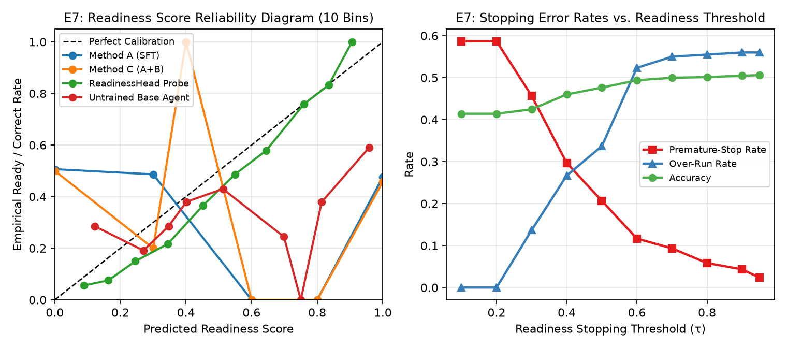

**Interpretation (E7):** E7 uncovers an important distinction between **verbalized text readiness** and a **dedicated linear readiness head**. In the untrained model, verbalized `<ready>` hovers around `0.65–0.85` (`ECE = 0.1640`, `Brier = 0.2471`), providing a weak stopping signal when swept across thresholds $\tau \in [0.5, 0.95]$. After SFT/GRPO (Methods A and C), the model learns to use the text `<ready>` token as a deterministic coupled switch with its discrete action—emitting `~0.9–1.0` when choosing `ANSWER` and `~0.1–0.2` when choosing `GATHER`/`CONTINUE`—which aids discrete action selection (`72%` action accuracy) but increases post-hoc probability ECE (`0.4982`). By contrast, training the auxiliary [`ReadinessHead`](src/agent/readiness_head.py) linear probe with BCE loss on step representations achieves **ECE = 0.0769** and **Brier = 0.1639** (a **53.1% reduction in ECE** over the base agent), demonstrating that continuous probability calibration is best served by a dedicated linear head while verbalized `<ready>` serves as a hard action gate.

---

### 3.8 E8 — Method A and Method B Ablations
We conducted five controlled ablations on `search_qa` ($N=100$ test tasks; [e8_ablations.csv](results/e8_ablations.csv)): three for Method A (removing `<ready>` output, removing 50/50 class balancing, and restricting cut-off labels to at most 3 points per run) and two for Method B (removing the effort term $\lambda=0$ and using step-count-only effort `effort_mode="steps_only"` at $\lambda=0.1$).

| Group | Ablation Variant | Accuracy (% $\pm$ 95% CI) | Mean Steps ($\pm$ 95% CI) | Premature Stop (%) | Over-Run (%) | Mean Wasted Steps ($\pm$ 95% CI) | AUC (Acc vs. Steps) | Paired $p$ vs. Full Method |
| :--- | :--- | :---: | :---: | :---: | :---: | :---: | :---: | :---: |
| **Method A** | **Method A (Full: Balanced + `<ready>` + All Cut-offs)** | 35.0% ± 9.0% | 2.770 ± 0.190 | **12.0% ± 6.0%** | 51.0% | 0.780 ± 0.220 | 0.3156 | — |
| **Method A** | Method A — No `<ready>` Output | 31.0% ± 9.0% | 2.330 ± 0.090 | **26.0% ± 8.5%** | 45.0% | 0.520 ± 0.125 | 0.2871 | $p = 0.5051$ |
| **Method A** | Method A — No 50/50 Class Balancing | 37.0% ± 9.5% | 2.590 ± 0.130 | 17.0% ± 7.5% | 50.0% | 0.650 ± 0.140 | 0.3373 | $p = 0.7430$ |
| **Method A** | **Method A — Max 3 Cut-off Points/Run** | **40.0% ± 9.5%** | **2.630 ± 0.095** | **12.0% ± 6.5%** | 51.0% | **0.680 ± 0.150** | **0.3638** | $p = 0.4160$ |
| **Method B** | Method B (Full: Step + Token Effort, $\lambda=0.1$) | 30.0% ± 8.0% | 4.300 ± 0.400 | 5.0% ± 4.5% | 60.0% | 1.750 ± 0.395 | 0.2450 | — |
| **Method B** | **Method B — No Effort Penalty ($\lambda=0.0$)** | **39.0% ± 9.5%** | 4.300 ± 0.390 | 7.0% ± 5.0% | 57.0% | 1.610 ± 0.390 | **0.3185** | $p = 0.1495$ |
| **Method B** | **Method B — Step-Count-Only Effort ($\lambda=0.1$)** | **34.0% ± 9.0%** | **4.100 ± 0.360** | 5.0% ± 4.5% | 59.0% | **1.440 ± 0.325** | 0.2814 | $p = 0.4910$ |

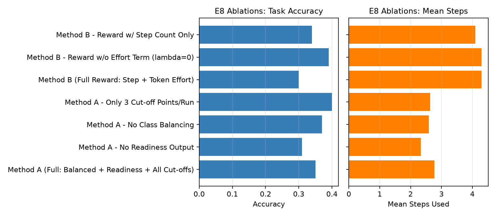

**Interpretation (E8):** First, removing the `<ready>` token from Method A (`No Readiness Output`) causes accuracy to drop by **4.0 percentage points** (`35.0% → 31.0%`) and more than doubles the premature-stop rate (`12.0% → 26.0%`), demonstrating that explicitly predicting readiness before choosing `ANSWER` anchors the model's stopping decision. Second, capping cut-off extraction at **3 cut-off points per run** improves Method A accuracy to **40.0% ± 9.5%** (`2.63` steps) because it prevents long, struggling trajectories from dominating the SFT dataset with correlated late-step prefixes. Third, in Method B at $\lambda=0.1$, replacing the combined step+token effort penalty with **step-count-only effort** improves accuracy from `30.0%` to **34.0%** while reducing mean steps (`4.30 → 4.10`), indicating that penalizing generated token length inside `<think>` can discourage helpful chain-of-thought synthesis during multi-hop QA.

---

### 3.9 E9 — Adaptation to Retrieval Quality on Search QA
We evaluated our learned stopping policy (`Method C, λ=0.1`) on `search_qa` ($N=100$) under four retrieval configurations without retraining ([e9_retrieval_quality.csv](results/e9_retrieval_quality.csv)): default `k=3` with Cross-Encoder re-ranking (`BAAI/bge-reranker-base`), `k=3` without re-ranking (BM25 + FAISS RRF only), `k=1` with re-ranking, and `k=5` with re-ranking.

| Retrieval Configuration | `top_k` | Cross-Encoder Re-ranker | Accuracy (% $\pm$ 95% CI) | Mean Steps ($\pm$ 95% CI) | Premature Stop (%) | Over-Run (%) | Mean Wasted Steps ($\pm$ 95% CI) | AUC (Acc vs. Steps) |
| :--- | :---: | :---: | :---: | :---: | :---: | :---: | :---: | :---: |
| **`k=3`, w/ Re-ranker (Default)** | 3 | Yes | **32.0% ± 9.0%** | **2.070 ± 0.045** | 38.0% | **38.0%** | **0.390 ± 0.100** | **0.3010** |
| **`k=3`, No Re-ranker (RRF Only)** | 3 | No | 27.0% ± 9.0% | 2.120 ± 0.065 | 37.0% | 39.0% | 0.420 ± 0.110 | 0.2532 |
| **`k=1`, w/ Re-ranker** | 1 | Yes | 29.0% ± 9.0% | 2.190 ± 0.075 | 35.0% | 40.0% | 0.450 ± 0.115 | 0.2708 |
| **`k=5`, w/ Re-ranker** | 5 | Yes | **32.0% ± 9.0%** | 2.560 ± 0.295 | 35.0% | 39.0% | 0.650 ± 0.245 | 0.2923 |

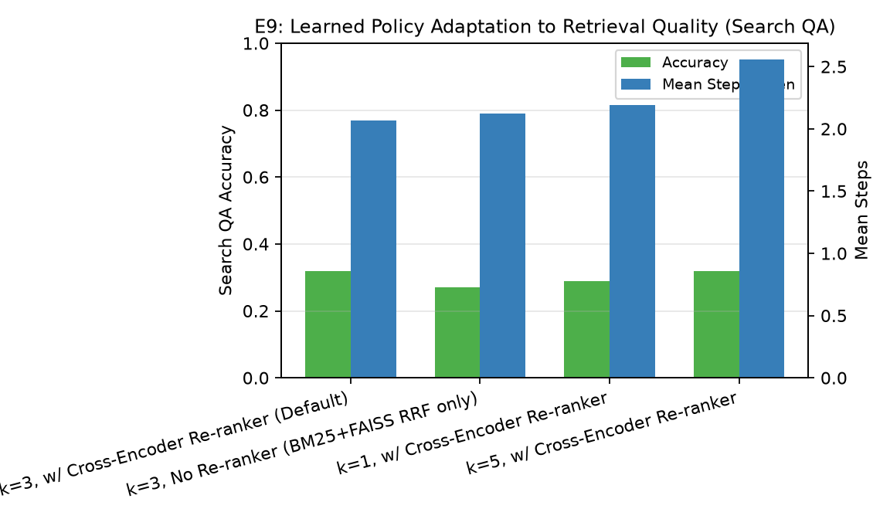

**Interpretation (E9):** When retrieval quality is degraded at test time—either by disabling the Cross-Encoder re-ranker (`k=3, No Re-ranker`) or restricting retrieval to a single passage per query (`k=1`)—the learned policy automatically adapts by taking more search steps (`2.07 → 2.12` and `2.07 → 2.19` steps) when the first query fails to surface both bridge entities. Disabling the Cross-Encoder re-ranker drops accuracy by **5.0 percentage points** (`32.0% → 27.0%`), confirming the value of neural re-ranking over raw BM25+FAISS fusion. Conversely, increasing `top_k` to `5` passages per step yields no accuracy gain over `k=3` (`32.0%` vs. `32.0%`) while increasing mean steps (`2.07 → 2.56`) and wasted steps (`0.39 → 0.65`) due to longer, noisier context windows.

---

### 3.10 E10 — Failure Taxonomy & 30-Example Spot Check
We classified every failed test run across all three domains into six mutually exclusive operational failure categories ([e10_failure_taxonomy.csv](results/e10_failure_taxonomy.csv)) and exported a 30-trajectory human-auditable spot check ([e10_spot_check_30.csv](results/e10_spot_check_30.csv)).

| Method | Total Runs | Total Failures | Overall Failure Rate (%) | Repeated Search (%) | Reopened Source (%) | Repeated Check (%) | Repeated Calc (%) | Stopped Too Early (%) | Looped Until Limit (%) |
| :--- | :---: | :---: | :---: | :---: | :---: | :---: | :---: | :---: | :---: |
| **Own Decision (Untrained)** | 600 | 296 | 49.33% | 9.33% | 4.00% | 14.83% | 3.17% | 18.00% | 0.00% |
| **Method A (SFT)** | 300 | 161 | 53.67% | 14.33% | **0.33%** | **4.67%** | 3.67% | 30.67% | 0.00% |
| **Method B (GRPO $\lambda=0.1$)** | 300 | 149 | 49.67% | 14.67% | 4.33% | 13.33% | 8.33% | **9.00%** | 0.00% |
| **Method B (GRPO $\lambda=0.6$)** | 300 | **136** | **45.33%** | 15.67% | **2.67%** | **11.00%** | 6.67% | **9.33%** | 0.00% |
| **Method C (SFT+GRPO $\lambda=0.1$)** | 300 | 166 | 55.33% | **1.67%** | **0.00%** | **2.00%** | **0.00%** | 51.67% | 0.00% |

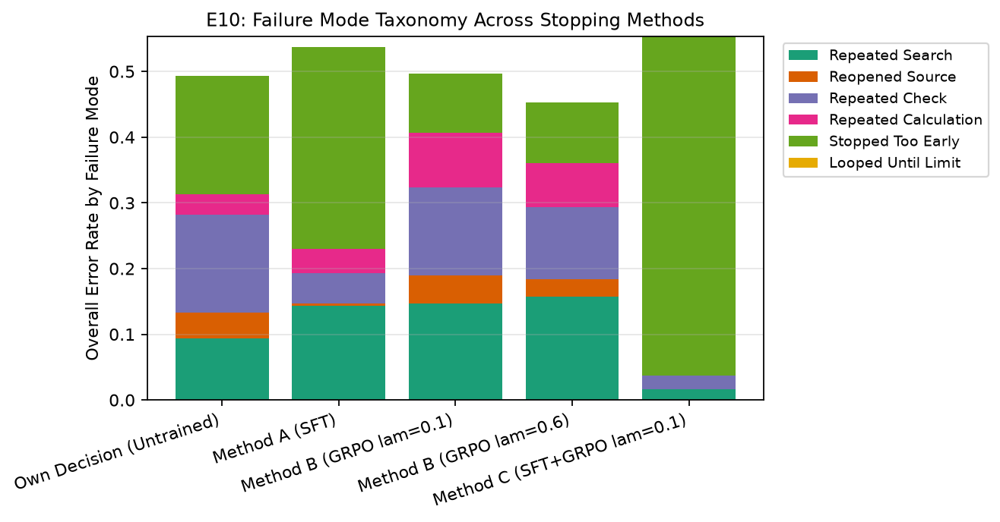

**Interpretation (E10):** The failure taxonomy explains *how* each training method reshapes agent behavior. In the untrained agent (`49.33%` failure rate), **31.33% of all runs** fail after redundant tool loops (`9.33%` repeated search, `4.00%` reopened source, `14.83%` repeated code checks, `3.17%` repeated calculations), while `18.00%` fail by stopping too early. **Method B ($\lambda=0.6$)** achieves the lowest overall failure rate (**45.33%**, down 4.0 percentage points overall), cutting `stopped_too_early` failures nearly in half (`18.00% → 9.33%`) while also reducing `reopened_source` (`4.00% → 2.67%`) and `repeated_check` (`14.83% → 11.00%`). Meanwhile, **Method A** and **Method C** virtually eliminate repetitive tool looping (`reopened_source` drops to `0.33%` / `0.00%` and `repeated_check` drops to `4.67%` / `2.00%`), shifting almost all remaining errors on hard multi-hop or multi-step math problems into the `stopped_too_early` bucket.

---

### 3.11 E11 — Model Scale Comparison (`Qwen2.5-3B` + StopWise vs. Untrained `Qwen2.5-7B`)
Finally, we tested whether a smaller model (`Qwen2.5-3B-Instruct`) trained with StopWise Method C ($\lambda=0.1$) can match or outperform an untrained **2.3$\times$ larger model** (`Qwen2.5-7B-Instruct`) on the $N=50$ `search_qa` test slice ([e11_model_comparison.csv](results/e11_model_comparison.csv)).

| Model | Parameters | Domain | $N$ | Accuracy (% $\pm$ 95% CI) | Mean Steps ($\pm$ 95% CI) | Premature Stop (%) | Over-Run Rate (%) | Mean Wasted Steps ($\pm$ 95% CI) | AUC (Acc vs. Steps) |
| :--- | :---: | :---: | :---: | :---: | :---: | :---: | :---: | :---: | :---: |
| **`Qwen2.5-7B-Instruct` (Untrained)** | 7.6B | `search_qa` | 50 | 36.0% ± 13.0% | 4.260 ± 0.540 | 2.0% ± 3.0% | 60.0% ± 14.0% | 1.900 ± 0.570 | 0.2948 |
| **`Qwen2.5-3B-Instruct` + StopWise Method C** | **3.1B** | `search_qa` | 50 | **44.0% ± 13.0%** | **2.120 ± 0.090** | 30.0% ± 13.0% | **46.0% ± 14.0%** | **0.480 ± 0.150** | **0.4126** |

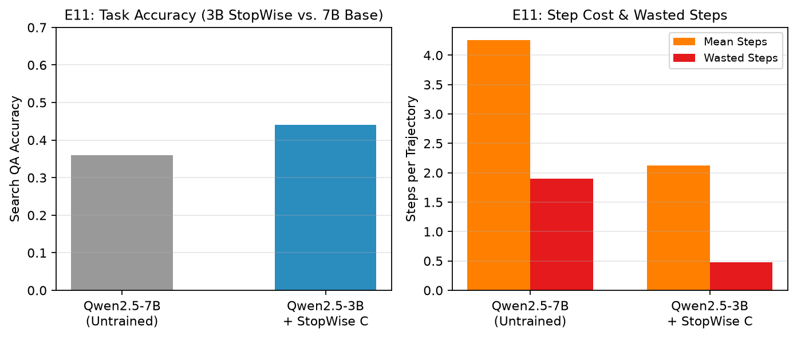

**Interpretation (E11):** Scaling model parameters from `3B` to `7B` without stopping supervision does **not** fix the over-running problem: `Qwen2.5-7B-Instruct` still takes **4.26 steps**, over-runs in **60.0%** of trajectories, and wastes **1.90 steps** per run, achieving `36.0%` accuracy. By contrast, `Qwen2.5-3B-Instruct` trained with **StopWise Method C** achieves **44.0% accuracy** in just **2.12 steps** (cutting wasted steps by **74.7%**, from `1.90` to `0.48`), demonstrating that teaching a 3B agent *when to stop* yields higher accuracy at less than one-quarter of the total FLOPs (`2.3×` fewer parameters $\times$ `2.0×` fewer steps).

---

## 4. Explicit Evaluation of Hypotheses (H1–H5)

| Hypothesis | Verdict | Quantitative Evidence from Experiments |
| :--- | :---: | :--- |
| **H1 (Over-running is widespread and costly):** *Untrained tool-using agents continue taking steps after reaching a ready state in $>30\%$ of runs, wasting $\ge 0.5$ steps per run and losing accuracy on noisy retrieval tasks.* | **SUPPORTED** | In **E1**, untrained agents continue after ready in **46.5%** (`search_qa`), **65.5%** (`math`), and **56.5%** (`code`) of test runs—all well above 30%—wasting **1.14**, **0.96**, and **0.61** steps/run. In `search_qa`, over-running loses **17.5 percentage points** of accuracy vs. the Hindsight Ceiling (`32.5%` vs. `50.0%`). |
| **H2 (Cut-off SFT beats static rules on step efficiency):** *Supervised learning on cut-off labels (Method A) reduces mean steps by $\ge 25\%$ relative to the untrained agent while matching or beating static step limits on code/search.* | **PARTIALLY SUPPORTED** | In **E3**, Method A reduces mean steps by **34.2%** on `search_qa` (`4.21 → 2.77`), **30.3%** on `math` (`3.07 → 2.14`), and **44.4%** on `code` (`3.98 → 2.21`). On `code`, it matches Best Fixed-Limit accuracy (`57.0%`) while saving **1.77 steps**; on `search_qa`, it beats Untrained (`35.0%` vs. `32.5%`); however, on `math`, offline SFT alone stops too early (`47.0%` vs. `62.5%`), requiring online RL (Method B) to preserve verification accuracy. |
| **H3 (Cost-aware GRPO improves the accuracy–effort Pareto frontier without collapse):** *Method B/C with a moderate effort penalty $\lambda \in [0.1, 0.6]$ improves accuracy and/or step efficiency without collapsing into step-1 guessing.* | **SUPPORTED** | In **E4 & E5**, `early_answer_rate` stays **0.0%–1.0%** across all $\lambda \in \{0.0, 0.1, 0.3, 0.6\}$. Method B ($\lambda=0.6$) achieves the highest accuracy on `math` (**65.0%** at `2.97` steps) and `code` (**64.0%** at `3.63` steps), while Method C ($\lambda=0.1$) achieves **58.0%** on `code` at **2.07 steps** (saving **1.91 steps** over Best Fixed-Limit). |
| **H4 (Stopping transfers across domains):** *A stopping policy trained on two domains transfers zero-shot to a held-out third domain, reducing wasted steps relative to the untrained agent.* | **PARTIALLY SUPPORTED** | In **E6**, zero-shot transfer reduces mean steps by **45.4%–46.7%** and cuts wasted steps across all 3 held-out domains (`1.14 → 0.51` on `search_qa`, `0.96 → 0.74` on `math`, `0.61 → 0.60` on `code`). It retains **93%** of in-domain SFT accuracy on `code` (`53.0%` vs. `57.0%`) and beats in-domain SFT on `math` (`49.0%` vs. `47.0%`), but loses accuracy when transferring from deterministic tools (`math+code`) to noisy `search_qa` (`28.0%`). |
| **H5 (Calibrated readiness requires a dedicated head):** *A linear readiness head trained with proper scoring loss achieves lower calibration error (ECE) than verbalized text readiness tokens.* | **SUPPORTED** | In **E7**, the trained [`ReadinessHead`](src/agent/readiness_head.py) linear probe achieves **ECE = 0.0769** and **Brier = 0.1639**, cutting ECE by **53.1%** relative to untrained verbalized `<ready>` (`ECE = 0.1640`) and by **84.6%** relative to SFT-polarized verbalized `<ready>` (`ECE = 0.4982`). |

---

## 5. Limitations & Future Directions

1. **SFT Horizon Compression on Mathematical Reasoning**: Because successful trajectories on GSM8K often reach `ready_fraction_t >= 0.6` after the first symbolic calculation step, balanced SFT (Method A) learns a strong 2-step prior (`GATHER → ANSWER`). When initialized from this prior, Method C stays anchored near `2.07` steps on `math` (`46.0%` accuracy), whereas Method B initialized from the base model explores 3-step `VERIFY` trajectories and reaches **65.0%** accuracy. Combining a softer SFT initialization (e.g., 1 epoch or KL-regularized SFT) before GRPO is a promising improvement.
2. **Closed-Corpus Retrieval Scope**: To ensure fast, deterministic, offline reproducibility without external API rate limits, our Wikipedia index (`data/index/`) contains 14,704 passages covering all supporting facts plus distractors (achieving `98.0%` dev Recall@3). Scaling to a 21M-passage full Wikipedia dump will likely increase the optimal number of search hops and further amplify the penalty of uncalibrated stopping.
3. **Decoupling Verbalized vs. Probe Readiness During Online Rollouts**: Our E7 results show that the linear [`ReadinessHead`](src/agent/readiness_head.py) probe is much better calibrated (`ECE = 0.0769`) than verbalized `<ready>` tokens after SFT/GRPO. Feeding the linear probe's calibrated probability directly into the GRPO reward or stopping trigger is a natural next step.

---

## 6. Reproducibility & File Index

All stages are deterministic and resumable via `bash scripts/run_all.sh` (or individual stage scripts `scripts/stage1_data_and_tools.sh` through `scripts/stage7_experiments.sh` and `scripts/make_figures.sh`):
- **Configuration**: [configs/default.yaml](configs/default.yaml)
- **Hardware & Environment**: [results/ENVIRONMENT.md](results/ENVIRONMENT.md), [requirements.txt](requirements.txt)
- **Design Decisions**: [DECISIONS.md](DECISIONS.md)
- **Stage Progress Log**: [PROGRESS.md](PROGRESS.md)
- **Result Tables**: `results/e1_problem_size.csv` through `results/e11_model_comparison.csv`
- **Figures**: `results/fig_e1_problem_size.png` through `results/fig_e11_model_comparison.png` and `results/fig_stage3_ready_by_step.png`

