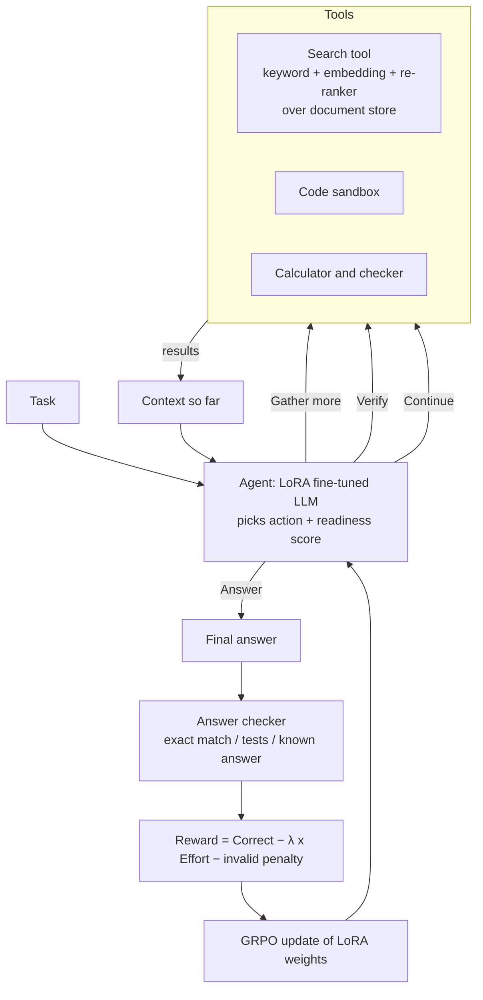
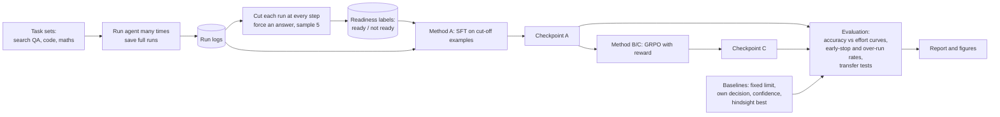

# StopWise: Teaching AI Agents When to Stop

**What it uses:** RAG (search over documents) + a fine-tuned LLM (LoRA) + a tool-using agent + reinforcement learning (GRPO)

---

## 1. Abstract (plain version)

AI agents work in steps: search, read, run code, check, repeat. Today most agents stop by one of two weak rules: a fixed step limit ("stop after 10 steps") or their own feeling that they are done. Both fail often. Some agents keep working long after they have the answer, which wastes time and money and sometimes even ruins a correct answer. Others stop too early and answer wrongly.

StopWise teaches an agent to judge whether it already has enough to answer. We get the training signal for free: take finished agent runs, cut each one at every step, force an answer at that point, and check if the answer was already right. That tells us exactly which moments were "ready to stop" and which were not. We then fine-tune a small model in three ways (learning from these cut-off examples, reinforcement learning with a reward that balances being right against effort, and both together), and test on three kinds of tasks: document search, coding with tools, and maths with checking. We measure how well each method keeps accuracy while using fewer steps, and whether a stopping skill learned on two task types carries over to a third.

---

## 2. Problem Statement

1. **Wasted work.** Agents search again after the evidence is already enough, re-run checks, repeat calculations and reopen files they have already read.
2. **Stopping too soon.** Agents sometimes answer before they have what they need.
3. **Bad rules.** A fixed step limit is wrong for easy tasks (too long) and for hard tasks (too short). The agent's own "I am done" is often unreliable.
4. **No clear measurement.** Few studies show, step by step, when an agent was actually ready to stop, so it is hard to compare stopping methods fairly.

**Central question:** *Can a small model learn a better stopping policy than a fixed step limit, and does that skill carry over to new kinds of tasks?*

---

## 3. The Idea in Simple Words

### 3.1 The agent's choices at each step
At every step, the agent picks one of four actions:
- **Continue** with the current plan (do the next planned action).
- **Gather more** (search again, open another file, run another tool).
- **Verify** (double check the current result).
- **Answer** (stop and give the final answer).

Alongside the action, it also gives a **readiness score** from 0 to 1: "how sure am I that I could answer correctly right now?"

### 3.2 Where the training labels come from (the "cut-off test")
1. Run an agent on many tasks and save every full run (every thought, tool call and result).
2. For each run and each step *t*, take everything up to step *t*, tell the agent "answer now", and sample a few answers.
3. Check them against the known correct answer.
4. Label step *t* as **ready** if most forced answers are right, otherwise **not ready**.

This gives a large labelled set, with no human labelling, of the form: *"At this exact point, was stopping safe?"*

### 3.3 Three training methods we compare
- **Method A, learn from cut-offs (SFT):** show the model the state at each step and teach it the right action: "answer" when the label is ready, otherwise the action the successful run took next.
- **Method B, learn from reward (GRPO):** let the model run full tasks and reward it for being right while using fewer steps.
- **Method C, both:** start from A, then improve with B.

### 3.4 The exact reward (used in Method B)
For one finished run:

```
Reward = Correct  −  λ × Effort  −  0.1 × (number of invalid actions)
```

- **Correct** = 1 if the final answer is right, else 0. "Right" means exact match for questions, passing all tests for code, and matching the known answer for maths.
- **Effort** = (tool calls + 0.001 × tokens generated) divided by the maximum allowed, so it lies between 0 and 1.
- **λ** (how much we care about effort) is a setting. We try several values (0, 0.1, 0.3, 0.6) to draw the accuracy-versus-effort curve.
- **Invalid action** = a badly formatted or non-existent action. Each costs 0.1.

An extra training term teaches the readiness score: its error is measured against the cut-off labels (binary cross-entropy).

**Why this reward can be cheated, and how we check:** if λ is large, the model may learn to answer at step 1 every time. We watch for this with an *early-answer rate* and a *right-answers-lost* count for every λ.

### 3.5 Baselines (what we must beat)
1. **Fixed step limit** (several values).
2. **Agent's own decision** (no training).
3. **Confidence rule:** stop when the answer's probability is above a cutoff.
4. **Hindsight best:** for each run, stop at the earliest step that was actually ready. This is the ceiling nobody can reach, but it shows the room for improvement.

---

## 4. System Design

### 4.1 AI parts versus normal software parts

| AI parts (learned or model-based) | Normal software parts (no learning) |
|---|---|
| Base language model with LoRA adapters (the agent) | Tool runner: search call, code sandbox, calculator |
| Readiness-score head (small layer on the model) | Retriever: keyword + embedding search, re-ranker (RAG) |
| Embedding model and re-ranker for retrieval | Document store and chunking pipeline |
| Reinforcement learning (GRPO) training loop | Trajectory logger and cut-off label builder |
| Optional: a MoE model as an alternative base | Answer checkers (exact match, unit tests, maths check) |
| | Evaluation scripts, statistics, plots |
| | (Later) demo user interface |

### 4.2 Architecture diagram



### 4.3 Data flow diagram



### 4.4 Tech Stack

Names are from memory; confirm current versions and that they work together before Day 1 **[verify]**.

| Need | Tool | Why |
|---|---|---|
| Base model | Qwen2.5-3B-Instruct (7B optional); small MoE such as Qwen3-30B-A3B or OLMoE-1B-7B as an optional extra | Small enough for one GPU with LoRA |
| Core framework | PyTorch + Hugging Face Transformers | Standard model loading and training |
| LoRA fine-tuning | PEFT | Trains small adapter weights only |
| SFT (Method A) | TRL `SFTTrainer` | Simple supervised fine-tuning |
| RL (Methods B, C) | veRL (used by Search-R1) or TRL `GRPOTrainer` | Ready-made GRPO training loop; pick one on Day 1 |
| Fast generation for runs and RL | vLLM | Many agent runs quickly |
| Keyword search | Pyserini (BM25) or `rank_bm25` | Classic keyword retrieval |
| Embedding search | FAISS + an embedding model (e5 or bge family) | Fast similarity search |
| Re-ranker | A cross-encoder re-ranker (bge-reranker family) | Orders the top passages better |
| Code sandbox | Docker or restricted subprocess with time and memory limits | Safe execution of agent code |
| Maths tools | Python `sympy` / calculator function | Exact arithmetic and checking |
| Answer checking | Exact-match and F1 scripts, unit-test runner | Reward and evaluation |
| Experiment tracking | Weights & Biases or TensorBoard | Compare runs |
| Statistics and plots | pandas, NumPy, SciPy, matplotlib | Confidence ranges, paired tests |
| Packaging | Docker, a pinned `requirements.txt` | Same setup for all three people |
| Demo (parked) | Streamlit or Gradio | Fast to build, last stage only |

**Hardware:** one 48 GB GPU is enough for a 3B model with LoRA and RL; 7B with LoRA is tight, so do 3B first. Disk space is needed for the passage index and the saved runs.

### 4.5 Datasets

Check licences and download links on Day 1 **[verify]**.

| Role | Dataset | Used for |
|---|---|---|
| Search knowledge source | Wikipedia dump split into about 100-word passages (the version used by Search-R1 / DPR) | The document store the search tool reads |
| Search questions (train and test) | HotpotQA | Multi-step questions needing two or more passages |
| Search questions (transfer and test) | 2WikiMultiHopQA, MuSiQue | Harder multi-step questions, and tests on unseen question styles |
| Optional extra training questions | Natural Questions | Easier single-step questions for variety |
| Maths tasks | GSM8K (optionally a small MATH subset) | Word problems with exact answers, calculator and check steps |
| Code tasks | MBPP (train and test), HumanEval (test only) | Small coding problems with unit tests |
| Retrieval embedding and re-ranker | Pretrained checkpoints (no extra data needed) | Search quality |
| Our own data | Saved agent runs and the cut-off labels | Training Method A, calibration, hindsight ceiling |

**How we split the data**
- Each dataset is split into train, validation and test, and the test sets are never used during training.
- For the transfer experiment (E6), one whole task type is held out from training and used only for testing.
- Runs from one task never appear in both training and test sets.
- A fixed random seed is used for every split so all three people get the same data.

**Size guide (so the work fits the time):** about 2,000-4,000 training tasks per domain, 300-500 test tasks per domain, and 4-8 saved runs per task. Reduce these if collection takes too long, but keep the test sets the same for all methods.

---

## 5. Steps to Build It End to End

**Step 1: Pick models and tasks**
- Base model: a 3B instruction model (7B only if time allows). A MoE model is an optional extra comparison, only if it fits memory.
- Search tasks: HotpotQA, 2WikiMultiHopQA and MuSiQue with a Wikipedia passage index.
- Coding tasks: small problems with tests (such as MBPP-style).
- Maths tasks: word problems with known answers (such as GSM8K-style), where the agent can use a calculator and a check step.
- Confirm that each dataset can be downloaded before committing.

**Step 2: Build the tools (the RAG part and others)**
- Search tool: keyword search plus embedding search, then a re-ranker. Chunk passages and return the top few.
- Code sandbox with a time limit, and a calculator tool.
- A fixed format for every action so the model's output can be read reliably.

**Step 3: Collect agent runs**
- Run the base agent several times on every task. Save every step, tool result and final answer.
- Add some runs from a stronger model or with a longer budget so there are many successful runs.

**Step 4: Build the cut-off labels**
- For each step in each run, force an answer five times and score them.
- Store the ready / not-ready label, and the "hindsight best" step for each run.
- First look: plot how many steps are wasted (steps after "ready") and how many runs stop too early.

**Step 5: Train Method A (learning from cut-offs)**
- Balance the data so "ready" and "not ready" appear about equally.
- Fine-tune with LoRA to output the action and the readiness score.

**Step 6: Train Method B and C (reinforcement learning)**
- Method B: GRPO from the untrained base model. Method C: GRPO starting from Method A.
- Use the reward in section 3.4. Sweep λ.
- Do not train on tool-result text (only on the agent's own words), as in Search-R1.

**Step 7: Run all experiments in section 6.**

**Step 8: Analysis and report**
- Plots, statistics, failure breakdown, written conclusions.

**Step 9 (parked): demo interface**
- A simple page showing the agent's steps live, the readiness score rising and falling, and a marker where it chose to stop. This is built last, only if time remains, and nothing else depends on it.

---

## 6. Experiments to Verify the Results

For all experiments: 3 training seeds, 95% confidence ranges by resampling (bootstrap), and paired tests on the same tasks.

**E1. How big is the problem?** (no training)
- On the untrained agent, measure: share of runs that go on after being ready, average wasted steps, share of runs that stop too early.
- *Proves:* the problem is real and sizeable in all three task types.

**E2. Baselines**
- Fixed limits, agent's own decision, confidence rule, hindsight best.
- *Output:* accuracy-versus-steps curve for each.

**E3. Method A alone**
- *Question:* does learning from cut-offs beat the baselines?
- *Output:* accuracy-versus-steps curve; early-stop rate; over-run rate.

**E4. Method B alone, with different λ**
- *Question:* does reward-based training find a good stopping policy, and where does it cheat?
- *Output:* curve for each λ; early-answer rate; right-answers-lost.

**E5. Method C (A then B)**
- *Question:* is the combination better than either alone?
- *Output:* the best curve per domain, compared with the hindsight ceiling.

**E6. Transfer to new tasks**
- Train on two task types, test on the third (three combinations).
- *Question:* is "knowing when to stop" a general skill or tied to one task type?

**E7. Is the readiness score trustworthy?**
- Compare predicted score with actual correctness (calibration plot and error rate).
- *Question:* when the model says 0.9, is it right about 90% of the time?

**E8. Ablations (remove one piece at a time)**
- No readiness score; no balanced data; fewer cut-off points; reward without effort term; reward with only the step count.
- *Output:* a table showing what each piece is worth.

**E9. RAG-specific check**
- Vary retrieval quality (no re-ranker, fewer or more passages).
- *Question:* does the learned stopping policy adapt when the search results get worse, for example by searching more?

**E10. Failure breakdown**
- Sort all mistakes into: repeated search, reopened file, repeated check, repeated calculation, stopped too early, looped without end.
- *Output:* a table showing which method fixes which kind of failure.

**E11. (Optional) MoE comparison**
- Repeat the best method on a small MoE model and compare with the dense one. Report training stability and accuracy only.

**What the finished report should show**
- Accuracy-versus-effort curve per domain and per method, with ranges.
- Early-stop versus over-run rates.
- Transfer results.
- Calibration plot.
- Failure table.
- Gap to the hindsight ceiling.

---

## 7. Plan (day by day, three people)

| Days | Person A: data and RAG | Person B: model and training | Person C: agent, tools, evaluation |
|---|---|---|---|
| 1-2 | Passage index, task sets, answer checkers | Base model setup, LoRA pipeline test | Action format, tool runner, sandbox, run logger |
| 3-4 | Collect runs, build cut-off labels, E1 | Method A training | Baselines (E2), evaluation scripts |
| 5-6 | Retrieval variants (E9), more data if needed | Method B/C training, λ sweep | E3, E4 runs, early-answer checks |
| 7-8 | Transfer setup (E6) | Method C final runs, ablations (E8) | E5, E7 calibration, failure sorting (E10) |
| 9-10 | Figures and statistics | Optional MoE (E11), extra seeds | Report writing; demo UI only if time |

**Must keep:** the cut-off label builder, all baselines, Method A, one working RL setting, and two domains. **Cut first:** MoE (E11), then the third domain, then the demo UI.

---

## 8. Literature Review

**Verified** = found in this session's searches (ID or venue given). **[verify]** = cited from memory; check title, authors and year before submitting.

### 8.1 Knowing when an agent should stop
- Luo, Wen, Wang. **Agentic Abstention: Do Agents Know When to Stop Instead of Act?** arXiv:2606.28733 (Jun 2026). Defines when a tool-using agent should stop, with a benchmark of over 28,000 tasks, and shows most systems stop late or never. *Closest related work; it studies the problem and a prompt-based fix (CONVOLVE) with no weight updates. We train the stopping skill and learn it from cut-off labels.*
- **ThinkBrake: Mitigating Overthinking in Tool Reasoning.** NeurIPS 2025. Shows that cutting reasoning at the right sentence lifts tool-call accuracy and saves a large share of tokens. Uses a training-free rule. *Supports our "cut-off test" idea and the hindsight ceiling.*
- Nagle et al. **TERMINATOR: Learning Optimal Exit Points for Early Stopping in Chain-of-Thought Reasoning.** arXiv:2603.12529 (Mar 2026). Learns to predict when a model's answer first appears. *Same spirit for single-model reasoning; ours is for multi-step agents.*
- Ning et al. **Agent-Omit: Training Efficient LLM Agents for Adaptive Thought and Observation Omission via Agentic RL.** arXiv:2602.04284. Trains agents to leave out useless thoughts and observations with RL. *Related efficiency goal; omits content rather than deciding when to stop.*
- **AutoSearch: Adaptive Search Depth for Efficient Agentic RAG via RL.** Findings of ACL 2026. Controls how deep search goes using intermediate answers. *Closest on the search side.*

### 8.2 RL-trained search and tool agents
- Jin et al. **Search-R1.** arXiv:2503.09516. Reasoning interleaved with search, trained with RL; retrieved text left out of the loss. *Base recipe for our RL training.*
- R1-Searcher, ReSearch, DeepResearcher, StepSearch [verify].
- Chroma **Context-1** (open search agent that trims its own context, 2026 blog/report) [verify details].

### 8.3 Training methods
- Shao et al. **DeepSeekMath** (introduces GRPO) and DeepSeek-AI **DeepSeek-R1** [verify].
- Hu et al. **LoRA** [verify]. **DAPO** (a GRPO variant addressing length effects) [verify].
- Concise-reasoning and overthinking papers cited inside TERMINATOR (for example Luo et al. 2025, Chen et al. 2025) [verify via its reference list].

### 8.4 Agents and retrieval basics
- Yao et al. **ReAct**; Asai et al. **Self-RAG**; Trivedi et al. **IRCoT** [verify].
- Datasets: **HotpotQA**, **2WikiMultiHopQA**, **MuSiQue**, **GSM8K**, **MBPP** [verify].

---

## 9. What Is New, and What to Check Before Claiming It

- **Our contribution:** (i) labelling "ready to stop" at every step of an agent run using forced-answer cut-offs; (ii) comparing cut-off training, reward training and both, across three task types; (iii) testing transfer of the stopping skill to unseen task types; (iv) a readiness score whose trustworthiness we measure.
- **Honest risk:** this area is active. Agentic Abstention (Jun 2026) and AutoSearch overlap in goals. Our difference is learned stopping from cut-off labels, plus cross-domain transfer and calibration. Run one more search of arXiv and ACL for Jul-Nov 2026 before claiming novelty.
- **Not covered here:** unsolvable tasks (agent should refuse to continue) are an optional extension that links directly to Agentic Abstention.
